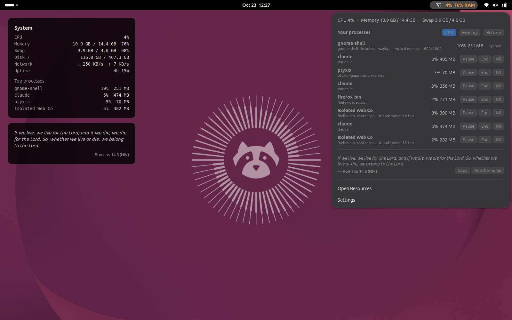

# Vigil

Keep watch over your machine, with a daily Bible verse. System monitoring for the Linux desktop, in two editions:

- **GNOME Shell extension** (`gnome/`): for Ubuntu and other GNOME desktops, including Wayland, where Conky can't sit on the desktop. Interactive: pause, resume, end or kill processes from the top bar.
- **Conky** (`conky.conf`, `lua/`): the original, for X11 desktops.

## GNOME edition



- **Top bar:** CPU and memory (optionally swap). It turns orange when memory or swap passes the warning level (90% by default).
- **Click it** for your top processes, sorted by CPU or memory. Each row shows what the process really is (`node … svelte-check`, not just `node`) and has **Pause / Resume / End / Kill**:
  - End asks politely (SIGTERM); Kill forces it (SIGKILL). Both need a second click unless you turn that off.
  - The list is taken when the menu opens and doesn't reorder under your pointer. A button only ever signals the exact process it was shown for, even if its PID has since been reused.
  - Only your own processes are listed, and desktop essentials (GNOME Shell, audio, session services) are marked `system` with no buttons.
- **Verse of the day** from OurManna, cached for the day, with **Copy** and **Another verse**. Offline, it uses 20 bundled KJV verses (or set it to use only those).
- **Desktop card:** the Conky look (system info, top processes, verse), drawn behind all windows. Pick the corner and margins, or turn it off.
- **Settings** for all of it, from the menu.

### Install

```bash
git clone https://github.com/kigathi-chege/vigil.git
cd vigil
./gnome/install.sh          # then log out and back in once (Wayland loads new extensions at login)
```

- `./gnome/install.sh --link` symlinks instead of copying, for working on it.
- `./gnome/install.sh --pack` builds a zip for `gnome-extensions install` or extensions.gnome.org.
- `./gnome/install.sh --remove` uninstalls.

Needs GNOME Shell 50 (Ubuntu 26.04). Nothing else to install.

### Tests

- `gjs -m gnome/tests/signals.test.js` pauses, resumes and ends a throwaway `sleep`, and checks the stale-PID guard and the protected list.
- `gnome/tests/headless.sh [out-dir]` runs the extension in a throwaway headless GNOME Shell, opens the menu, disables and re-enables it, and saves screenshots. It runs in its own D-Bus session with keyfile settings, so it never touches your real session.

## Conky edition (X11)

A modular, reusable Conky widget framework with Cairo graphics rendering.

## Project Structure

```
conky/
├── conky.conf          # Main Conky configuration
├── lua/
│   ├── core.lua        # Shared drawing functions and theme
│   ├── layout.lua      # Widget positioning and management
│   └── widgets/
│       ├── bible.lua   # Bible verse widget
│       └── system.lua  # System information widget
└── cache/
    └── verse.json      # Bible verse cache (auto-created)
```

## Installation

**Quick Install:**
```bash
# Clone the repository
git clone https://github.com/kigathi-chege/vigil.git
cd vigil

# Copy to Conky config directory and start
cp -r . ~/.config/conky && conky -c ~/.config/conky/conky.conf
```

**Manual Install:**
```bash
# Clone the repository
git clone https://github.com/kigathi-chege/vigil.git

# Run from any location
conky -c /path/to/vigil/conky.conf
```

The framework uses relative paths - no configuration needed regardless of installation location.

## Architecture

### Core Framework (`core.lua`)
- **Theme System**: Centralized color, font, and spacing configuration
- **Drawing Helpers**: Rounded rectangles, card backgrounds, text wrapping
- **Text Rendering**: Multi-line text, right-aligned text, font management
- **Cache Utilities**: JSON file reading/writing helpers

### Layout Manager (`layout.lua`)
- **Widget Registry**: Priority-based widget ordering
- **Column Layout**: Automatic column wrapping when height exceeded
- **Dynamic Sizing**: Widgets can calculate their own height requirements
- **Spacing Management**: Consistent padding between widgets

### Widget System
Each widget follows the signature: `widget_function(cr, x, y, width, height)`

**Bible Widget** (`widgets/bible.lua`):
- Smart API fetching (startup + random daily updates)
- Local caching with graceful fallbacks
- Automatic text wrapping for long verses
- Right-aligned reference text

**System Widget** (`widgets/system.lua`):
- Real-time system information display
- Conky variable integration
- Consistent card-based design

## Adding New Widgets

1. **Create widget file** in `lua/widgets/yourwidget.lua`:
```lua
function your_widget(cr, x, y, width, height)
    -- Draw card background
    draw_card_background(cr, x, y, width, height)
    
    -- Your widget content here
    -- Use theme.* for consistent styling
    
    return height  -- or calculated height
end
```

2. **Register widget** in `layout.lua`:
```lua
local widgets = {
    {priority = 1, width = 400, height = 180, draw = system_widget},
    {priority = 2, width = 400, height = 200, draw = bible_widget},
    {priority = 3, width = 400, height = 150, draw = your_widget}  -- Add here
}
```

3. **Require widget** in `layout.lua`:
```lua
require("widgets.yourwidget")
```

## Customization

### Theme Configuration
Edit the `theme` table in `core.lua`:
```lua
theme = {
    card_bg_color = {0, 0, 0, 0.8},        -- RGBA background
    card_border_color = {1, 1, 1, 0.2},    -- RGBA border
    text_color = {1, 1, 1, 0.9},           -- Primary text
    text_secondary_color = {0.8, 0.8, 0.8, 0.8}, -- Secondary text
    font_verse = "DejaVu Sans",             -- Font families
    font_size_verse = 14,                   -- Font sizes
    card_corner_radius = 12,                -- Corner radius
    card_padding = 20,                      -- Internal padding
    widget_spacing = 15                     -- Space between widgets
}
```

### Layout Configuration
Edit the `layout` table in `layout.lua`:
```lua
local layout = {
    start_x = 0,                    -- Starting X position
    start_y = 0,                    -- Starting Y position
    max_column_height = 800,        -- Max height before new column
    column_width = 420              -- Width of each column
}
```

## Portability

The framework is fully portable:
- **No hardcoded paths** - uses relative paths from config file location
- **Auto-detects project root** - works regardless of installation directory
- **Self-contained** - all dependencies included in project structure
- **Cross-machine compatible** - copy entire directory and run anywhere

## Features Preserved

- **Visual Design**: Rounded cards, translucent backgrounds, soft borders
- **Smart API Management**: Bible verse caching and intelligent fetching
- **Text Wrapping**: Automatic line breaking for long content
- **Performance**: Efficient Cairo rendering with minimal API calls

## Requirements

- Conky with Cairo support
- Lua 5.1+
- curl (for Bible verse fetching)
- X11 desktop environment
